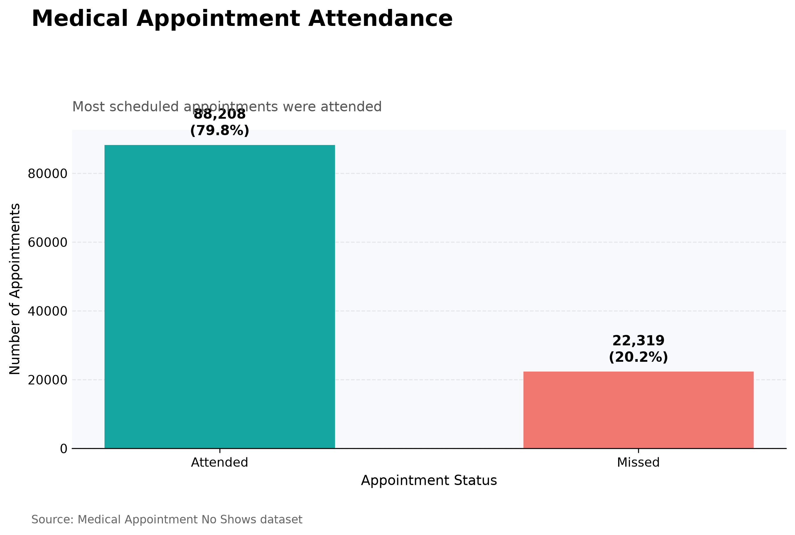
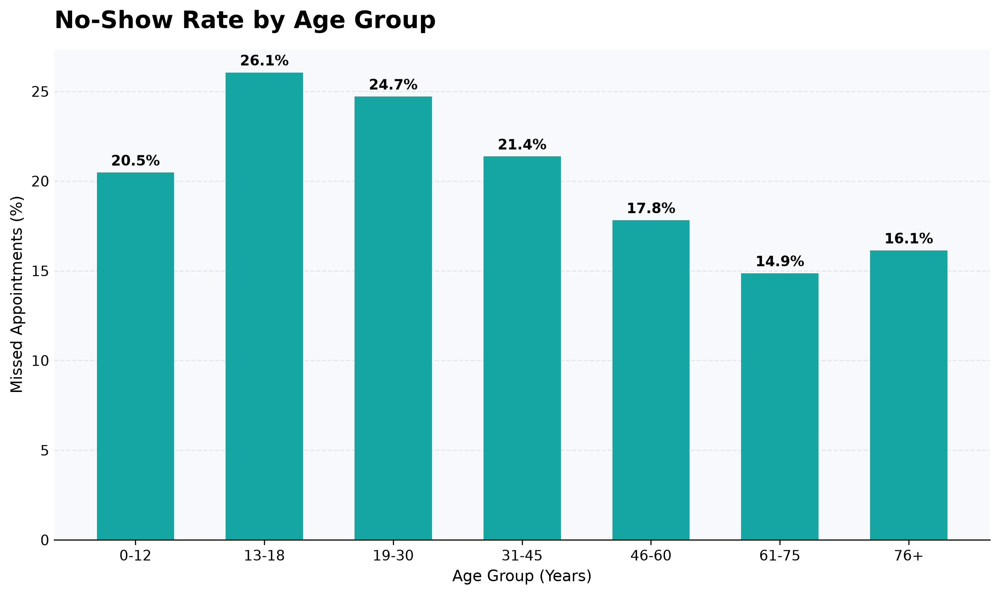
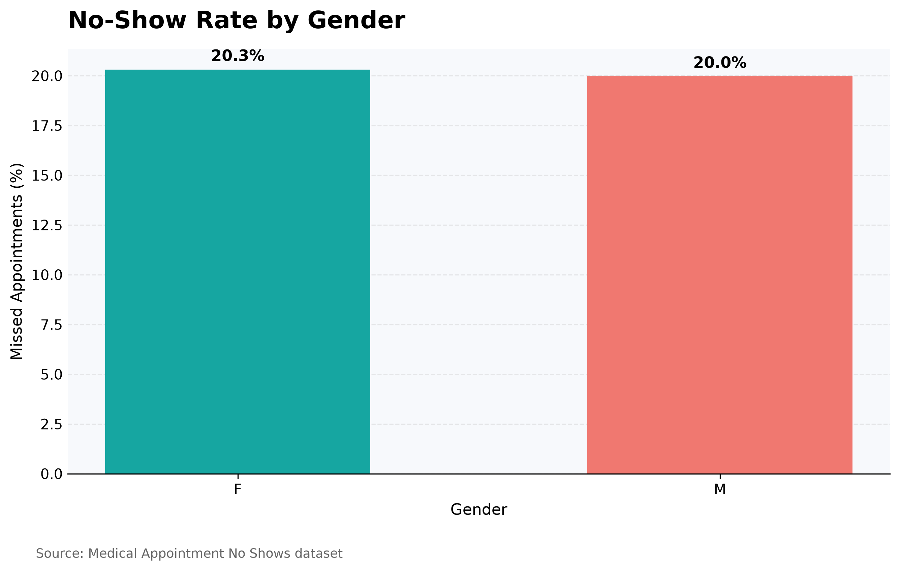
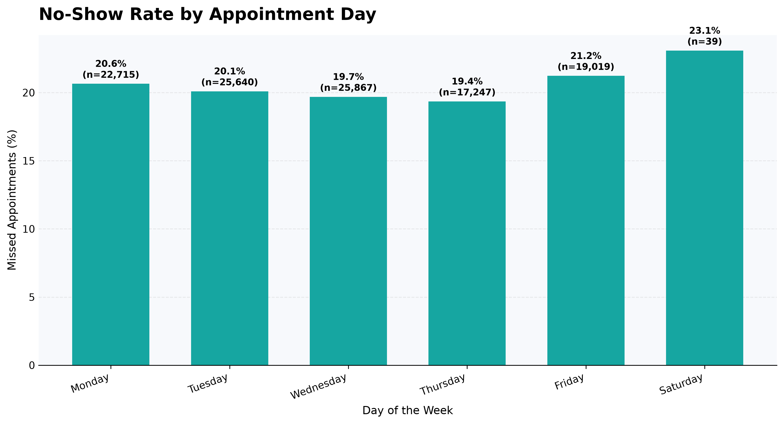
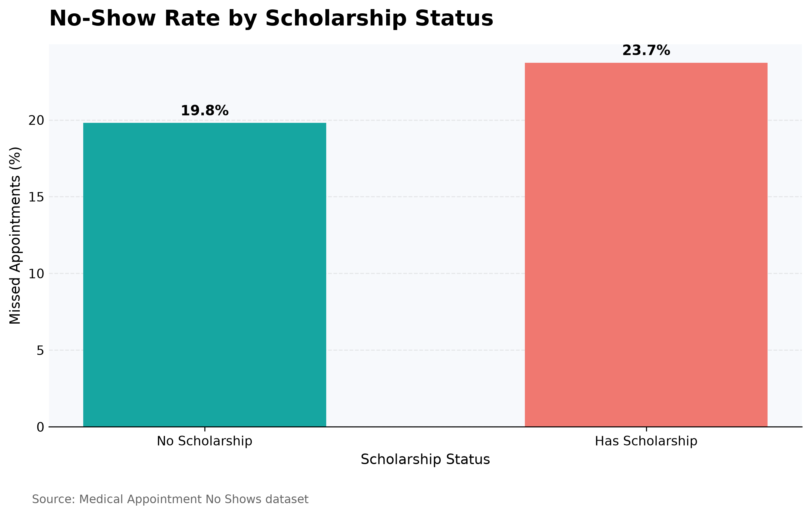

# Medical Appointment Data Visualization

**CodeAlpha Data Analytics Internship | Task 3**

## 1. Project Overview

For this project, I used Python to analyze a medical appointment dataset and create charts showing patient attendance patterns.

The aim was to find out how many patients attended their appointments, how many missed them, and whether no-show rates differed by age group, gender, appointment weekday, and scholarship status.

I used Pandas to analyze the data and Matplotlib to create the visualizations.

## 2. Dataset

The project uses the **Medical Appointment No Shows** dataset, originally published on Kaggle.

The dataset contains 110,527 appointment records and 14 columns. These include patient age, gender, appointment dates, neighborhood, scholarship status, medical conditions, SMS reminders, and appointment attendance.

The `No-show` column indicates whether a patient missed an appointment:

* `No` means the patient attended.
* `Yes` means the patient missed the appointment.

## 3. Tools Used

* **Python** — for writing and running the analysis.
* **Pandas** — for organizing and analyzing the dataset.
* **Matplotlib** — for creating the charts.
* **Visual Studio Code** — for writing and running the Python script.

## 4. Visualizations and Findings

### Chart 1: Overall Appointment Attendance

Out of 110,527 appointments, 88,208 were attended and 22,319 were missed.

This means approximately **79.8% of appointments were attended, while 20.2% were missed**.

The chart gives an overall picture of appointment attendance in the dataset.

### Chart 2: No-Show Rate by Age Group

The no-show rate differed across age groups.

The 13–18 age group had the highest rate at 26.1%, while the 61–75 age group had the lowest at 14.9%.

This shows that attendance patterns varied across age groups. However, the chart does not explain why these differences occurred.

### Chart 3: No-Show Rate by Gender

The no-show rate was 20.3% for female patients and 20.0% for male patients.

The difference was only 0.3 percentage points, meaning the rates were very similar in this dataset.

### Chart 4: No-Show Rate by Appointment Weekday

Friday had a no-show rate of approximately 21.2%, while Thursday had the lowest rate among the weekdays with recorded appointments, at approximately 19.4%.

Saturday had a rate of 23.1%. However, only 39 appointments were recorded on Saturday, compared with thousands on most other days. This means the Saturday result should be interpreted carefully.

There were no Sunday appointments in the dataset.

### Chart 5: No-Show Rate by Scholarship Status

Patients without the scholarship indicator had a no-show rate of 19.8%, compared with 23.7% for patients with the indicator.

The difference was 3.9 percentage points.

This shows a difference between the two groups, but the data alone cannot explain why it occurred.

## 5. Summary of Findings

The main findings from the analysis were:

* Most appointments were attended, but approximately one in five was missed.
* The 13–18 age group had the highest no-show rate among the age groups analyzed.
* Female and male patients had very similar no-show rates.
* Friday had a higher no-show rate than most other weekdays with substantial appointment numbers.
* Patients with the scholarship indicator had a higher no-show rate than those without it.

These findings describe patterns in the dataset. Further analysis would be needed to understand the reasons behind them.

## 6. Data Quality Checks

Before creating the visualizations, I checked the dataset for missing values and duplicate records.

My initial checks found no missing values in the columns examined and no duplicate rows.

I also identified:

* One record with a negative age.
* Seven records with ages above 100.

The negative-age record was excluded from the age-group analysis because the value was invalid. The original dataset was not changed.

These checks helped me identify values that needed attention before interpreting the age-related results.

## 7. Limitations

There are a few things to consider when interpreting the results:

* The analysis shows patterns but does not establish the causes of missed appointments.
* The Saturday result is based on only 39 appointments.
* The dataset may not represent every healthcare facility or patient population.
* Unusual age values may affect the interpretation of age-related results.

## 8. Project Files

The project folder contains the following files:

| File                         | Description                                                   |
| ---------------------------- | ------------------------------------------------------------- |
| `visualization.py`           | Python script used to analyze the data and create the charts. |
| `KaggleV2-May-2016.csv`      | Dataset used for the analysis.                                |
| `appointment_attendance.png` | Chart showing overall attendance.                             |
| `no_show_by_age_group.png`   | Chart comparing age groups.                                   |
| `no_show_by_gender.png`      | Chart comparing gender groups.                                |
| `no_show_by_weekday.png`     | Chart comparing appointment weekdays.                         |
| `no_show_by_scholarship.png` | Chart comparing scholarship groups.                           |

## 9. How to Run the Project

To run the project on your computer:

1. Install Python.

2. Install the required libraries by running:

   `pip install pandas matplotlib`

3. Download the dataset and place `KaggleV2-May-2016.csv` in the same folder as `visualization.py`.

4. Open the project folder in Visual Studio Code.

5. Open the terminal and run:

   `python visualization.py`

The script will perform the analysis, display the charts, and print the key findings in the terminal.

## 10. What I Learned

Working on this project gave me practical experience using Python and Pandas to explore a dataset and Matplotlib to present findings visually.

I also learned the importance of checking data quality before interpreting results. For example, Saturday had a relatively high no-show rate, but the small number of appointments recorded that day showed why the result needed to be treated cautiously.

## 11. Conclusion

This project helped me explore medical appointment data using Python and present the results through visualizations. The analysis showed that most appointments were attended, although no-show rates varied across age groups, weekdays, gender, and scholarship status.

One important lesson was that the results need to be interpreted carefully. A high percentage does not always tell the whole story, especially when it is based on a small number of records.

